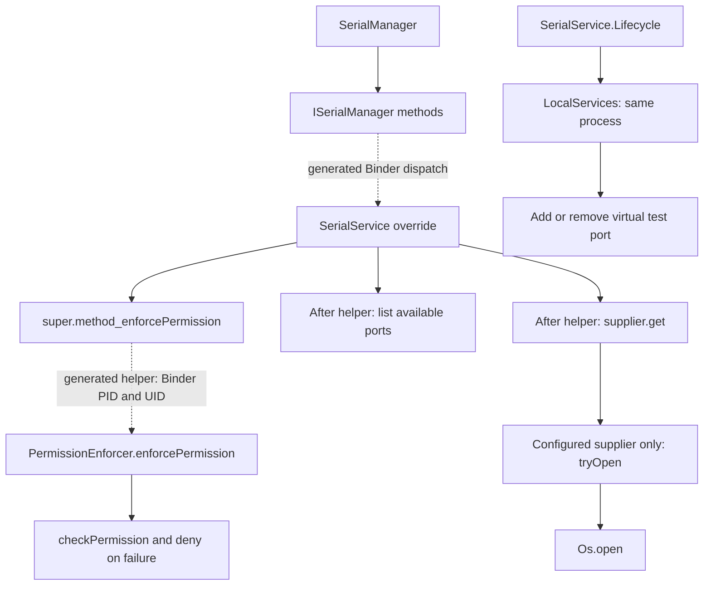
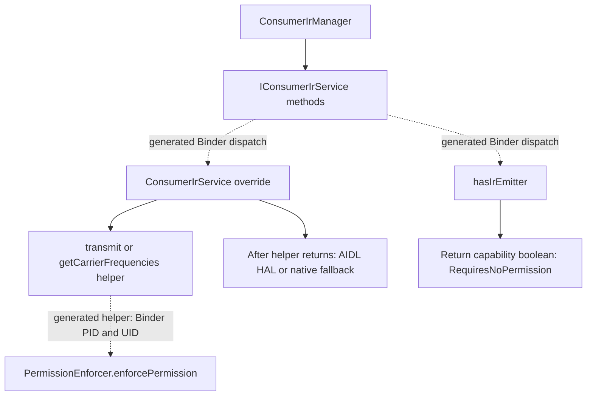

# AOSP Call Graph Review — DarkForge-X Phase Two

**Source-backed observations, not confirmed vulnerabilities. Zero independently validated permission bypasses.**

کورتەی ئەنجام: دوو Service، پێنج Binder entry point و دوو local method شیکرانەوە. چوار entry point ـی پارێزراو helper ـی permission پێش کردارەکە بانگ دەکەن. هیچ Permission Bypass ـێک پشتڕاست نەکراوەتەوە؛ تاقیکردنەوەی Android Runtime جێبەجێ نەکراوە.

## Scope and provenance

Phase one was read first: its nine PermissionEnforcer pattern hits were not vulnerabilities. This phase selects two small services, five Binder interface methods and two same-process local methods. Discovery is bounded, not an exhaustive AOSP caller inventory. GitHub indexed search returned no results; files were discovered/fetched by repository paths at immutable revisions.

Frameworks baseline: `1cdfff555f4a21f71ccc978290e2e212e2f8b168` (`aosp-mirror/platform_frameworks_base`).

AIDL generator reference: `a73091e714248afbf28a6d2ec3226d756288cc75` (`aosp-mirror-neo/platform_system_tools_aidl`). Chosen as a historical revision preceding the frameworks commit. **This is not a resolved multi-repository build manifest.** Compiler-generated dispatch and helper identity edges are inferred; no exact generated Stub artifact has been built or inspected.

Every vendored byte is verified against Git blob SHA and SHA-256 in two manifests under `vendor/phase2/`. The original phase-one snapshot and its nine unconfirmed records remain unchanged.

## Call graph legend

Solid arrows show calls or data routes visible in pinned source. Dashed arrows cross generated-code boundaries inferred from the independently pinned AIDL generator. Diagram operation arrows summarize execution order; they do not claim the helper calls the operation. The service invokes the helper, then continues only if it returns.





The generated helper is explicitly called by each protected service override. An AIDL annotation by itself is not treated as proof of enforcement. SerialService injects PermissionEnforcer explicitly; ConsumerIrService relies on its implicit superclass constructor, whose enforcer initialization is inferred from the generator reference.

## Review records

### SerialService.getSerialPorts

| Field | Evidence / assessment |
| --- | --- |
| Service Name | `SerialService` |
| Entry Point | `ISerialManager.getSerialPorts` |
| Caller Identity | Expected generated helper reads Binder getCallingPid()/getCallingUid(); not an observed runtime identity |
| Required Permission | android.permission.SERIAL_PORT |
| Enforcement Location | [services/core/java/com/android/server/SerialService.java:89](https://github.com/aosp-mirror/platform_frameworks_base/blob/1cdfff555f4a21f71ccc978290e2e212e2f8b168/services/core/java/com/android/server/SerialService.java#L89) |
| Protected Operation | ports.add(path) |
| Source File and Line | [services/core/java/com/android/server/SerialService.java:88](https://github.com/aosp-mirror/platform_frameworks_base/blob/1cdfff555f4a21f71ccc978290e2e212e2f8b168/services/core/java/com/android/server/SerialService.java#L88) |
| AOSP Commit | `1cdfff555f4a21f71ccc978290e2e212e2f8b168` |
| Confidence Level | {"observed_source": "high", "generated_dispatch_and_identity": "medium; inferred, compiler revision not build-manifest matched", "vulnerability": "not assessed as established"} |
| Validation Status | **Unconfirmed — Android runtime/emulator unavailable; source observations only** |
| Recommended Next Step | Generate the actual Stub from a resolved build manifest, then run authorized in-process Binder deny/allow tests with a fake sink; no serial/IR hardware calls. |

Source evidence:

- [core/java/android/hardware/ISerialManager.aidl:25](https://github.com/aosp-mirror/platform_frameworks_base/blob/1cdfff555f4a21f71ccc978290e2e212e2f8b168/core/java/android/hardware/ISerialManager.aidl#L25) — `@EnforcePermission("SERIAL_PORT")`
- [core/java/android/hardware/ISerialManager.aidl:26](https://github.com/aosp-mirror/platform_frameworks_base/blob/1cdfff555f4a21f71ccc978290e2e212e2f8b168/core/java/android/hardware/ISerialManager.aidl#L26) — `String[] getSerialPorts();`
- [core/java/android/hardware/SerialManager.java:55](https://github.com/aosp-mirror/platform_frameworks_base/blob/1cdfff555f4a21f71ccc978290e2e212e2f8b168/core/java/android/hardware/SerialManager.java#L55) — `return mService.getSerialPorts();`
- [services/core/java/com/android/server/SerialService.java:88](https://github.com/aosp-mirror/platform_frameworks_base/blob/1cdfff555f4a21f71ccc978290e2e212e2f8b168/services/core/java/com/android/server/SerialService.java#L88) — `public String[] getSerialPorts() {`
- [services/core/java/com/android/server/SerialService.java:89](https://github.com/aosp-mirror/platform_frameworks_base/blob/1cdfff555f4a21f71ccc978290e2e212e2f8b168/services/core/java/com/android/server/SerialService.java#L89) — `super.getSerialPorts_enforcePermission();`
- [core/res/AndroidManifest.xml:7133](https://github.com/aosp-mirror/platform_frameworks_base/blob/1cdfff555f4a21f71ccc978290e2e212e2f8b168/core/res/AndroidManifest.xml#L7133) — `<permission android:name="android.permission.SERIAL_PORT"`
- [services/core/java/com/android/server/SerialService.java:95](https://github.com/aosp-mirror/platform_frameworks_base/blob/1cdfff555f4a21f71ccc978290e2e212e2f8b168/services/core/java/com/android/server/SerialService.java#L95) — `ports.add(path);`

Security assessment:

- Permission before operation: `{"helper_is_first_statement": true, "helper_invocations": 1, "protected_calls": 1, "helper_before_all_protected_calls": true, "limitation": "Source order in selected method only; not a whole-program control-flow dominance proof"}`.
- Caller UID/PID: Expected generated helper reads Binder getCallingPid()/getCallingUid(); not an observed runtime identity. These selected AIDL methods are not declared oneway; Binder.java also warns PID may be zero in certain transactions. Native Binder credential behavior was not tested.
- Exceptions: catch types `[]`. No catch around the initial permission helper; IR RemoteException catches surround later HAL calls only.
- Binder identity: No explicit identity transition in this selected method body; no local clear/restore calls found in this body. This does not audit all callees.
- Alternate routes: Direct Java calls to the same override still execute its explicit helper. LocalServices mutation API is analyzed separately. Uninspected callers are not excluded.
- Permission suitability: SERIAL_PORT is signature|privileged and matches port access.

Runtime validation cases (planned, not executed):

| Case | Expected | Actual |
| --- | --- |
| negative: caller without required permission | SecurityException and zero fake-sink operations | **NOT RUN** |
| positive: authorized caller | Expected fake-sink operation/return, with Binder UID/PID recorded | **NOT RUN** |

### SerialService.openSerialPort

| Field | Evidence / assessment |
| --- | --- |
| Service Name | `SerialService` |
| Entry Point | `ISerialManager.openSerialPort` |
| Caller Identity | Expected generated helper reads Binder getCallingPid()/getCallingUid(); not an observed runtime identity |
| Required Permission | android.permission.SERIAL_PORT |
| Enforcement Location | [services/core/java/com/android/server/SerialService.java:104](https://github.com/aosp-mirror/platform_frameworks_base/blob/1cdfff555f4a21f71ccc978290e2e212e2f8b168/services/core/java/com/android/server/SerialService.java#L104) |
| Protected Operation | supplier.get() |
| Source File and Line | [services/core/java/com/android/server/SerialService.java:103](https://github.com/aosp-mirror/platform_frameworks_base/blob/1cdfff555f4a21f71ccc978290e2e212e2f8b168/services/core/java/com/android/server/SerialService.java#L103) |
| AOSP Commit | `1cdfff555f4a21f71ccc978290e2e212e2f8b168` |
| Confidence Level | {"observed_source": "high", "generated_dispatch_and_identity": "medium; inferred, compiler revision not build-manifest matched", "vulnerability": "not assessed as established"} |
| Validation Status | **Unconfirmed — Android runtime/emulator unavailable; source observations only** |
| Recommended Next Step | Generate the actual Stub from a resolved build manifest, then run authorized in-process Binder deny/allow tests with a fake sink; no serial/IR hardware calls. |

Source evidence:

- [core/java/android/hardware/ISerialManager.aidl:29](https://github.com/aosp-mirror/platform_frameworks_base/blob/1cdfff555f4a21f71ccc978290e2e212e2f8b168/core/java/android/hardware/ISerialManager.aidl#L29) — `@EnforcePermission("SERIAL_PORT")`
- [core/java/android/hardware/ISerialManager.aidl:30](https://github.com/aosp-mirror/platform_frameworks_base/blob/1cdfff555f4a21f71ccc978290e2e212e2f8b168/core/java/android/hardware/ISerialManager.aidl#L30) — `ParcelFileDescriptor openSerialPort(String name);`
- [core/java/android/hardware/SerialManager.java:77](https://github.com/aosp-mirror/platform_frameworks_base/blob/1cdfff555f4a21f71ccc978290e2e212e2f8b168/core/java/android/hardware/SerialManager.java#L77) — `ParcelFileDescriptor pfd = mService.openSerialPort(name);`
- [services/core/java/com/android/server/SerialService.java:103](https://github.com/aosp-mirror/platform_frameworks_base/blob/1cdfff555f4a21f71ccc978290e2e212e2f8b168/services/core/java/com/android/server/SerialService.java#L103) — `public ParcelFileDescriptor openSerialPort(String path) {`
- [services/core/java/com/android/server/SerialService.java:104](https://github.com/aosp-mirror/platform_frameworks_base/blob/1cdfff555f4a21f71ccc978290e2e212e2f8b168/services/core/java/com/android/server/SerialService.java#L104) — `super.openSerialPort_enforcePermission();`
- [core/res/AndroidManifest.xml:7133](https://github.com/aosp-mirror/platform_frameworks_base/blob/1cdfff555f4a21f71ccc978290e2e212e2f8b168/core/res/AndroidManifest.xml#L7133) — `<permission android:name="android.permission.SERIAL_PORT"`
- [services/core/java/com/android/server/SerialService.java:109](https://github.com/aosp-mirror/platform_frameworks_base/blob/1cdfff555f4a21f71ccc978290e2e212e2f8b168/services/core/java/com/android/server/SerialService.java#L109) — `return supplier.get();`

Security assessment:

- Permission before operation: `{"helper_is_first_statement": true, "helper_invocations": 1, "protected_calls": 2, "helper_before_all_protected_calls": true, "limitation": "Source order in selected method only; not a whole-program control-flow dominance proof"}`.
- Caller UID/PID: Expected generated helper reads Binder getCallingPid()/getCallingUid(); not an observed runtime identity. These selected AIDL methods are not declared oneway; Binder.java also warns PID may be zero in certain transactions. Native Binder credential behavior was not tested.
- Exceptions: catch types `[]`. No catch around the initial permission helper; IR RemoteException catches surround later HAL calls only.
- Binder identity: No explicit identity transition in this selected method body; no local clear/restore calls found in this body. This does not audit all callees.
- Alternate routes: Direct Java calls to the same override still execute its explicit helper. LocalServices mutation API is analyzed separately. Uninspected callers are not excluded.
- Permission suitability: SERIAL_PORT is signature|privileged and matches port access.

Runtime validation cases (planned, not executed):

| Case | Expected | Actual |
| --- | --- |
| negative: caller without required permission | SecurityException and zero fake-sink operations | **NOT RUN** |
| positive: authorized caller | Expected fake-sink operation/return, with Binder UID/PID recorded | **NOT RUN** |

### ConsumerIrService.transmit

| Field | Evidence / assessment |
| --- | --- |
| Service Name | `ConsumerIrService` |
| Entry Point | `IConsumerIrService.transmit` |
| Caller Identity | Expected generated helper reads Binder getCallingPid()/getCallingUid(); not an observed runtime identity |
| Required Permission | android.permission.TRANSMIT_IR |
| Enforcement Location | [services/core/java/com/android/server/ConsumerIrService.java:101](https://github.com/aosp-mirror/platform_frameworks_base/blob/1cdfff555f4a21f71ccc978290e2e212e2f8b168/services/core/java/com/android/server/ConsumerIrService.java#L101) |
| Protected Operation | mAidlService.transmit(, halTransmit(carrierFrequency, pattern) |
| Source File and Line | [services/core/java/com/android/server/ConsumerIrService.java:100](https://github.com/aosp-mirror/platform_frameworks_base/blob/1cdfff555f4a21f71ccc978290e2e212e2f8b168/services/core/java/com/android/server/ConsumerIrService.java#L100) |
| AOSP Commit | `1cdfff555f4a21f71ccc978290e2e212e2f8b168` |
| Confidence Level | {"observed_source": "high", "generated_dispatch_and_identity": "medium; inferred, compiler revision not build-manifest matched", "vulnerability": "not assessed as established"} |
| Validation Status | **Unconfirmed — Android runtime/emulator unavailable; source observations only** |
| Recommended Next Step | Generate the actual Stub from a resolved build manifest, then run authorized in-process Binder deny/allow tests with a fake sink; no serial/IR hardware calls. |

Source evidence:

- [core/java/android/hardware/IConsumerIrService.aidl:25](https://github.com/aosp-mirror/platform_frameworks_base/blob/1cdfff555f4a21f71ccc978290e2e212e2f8b168/core/java/android/hardware/IConsumerIrService.aidl#L25) — `@EnforcePermission("TRANSMIT_IR")`
- [core/java/android/hardware/IConsumerIrService.aidl:26](https://github.com/aosp-mirror/platform_frameworks_base/blob/1cdfff555f4a21f71ccc978290e2e212e2f8b168/core/java/android/hardware/IConsumerIrService.aidl#L26) — `void transmit(String packageName, int carrierFrequency, in int[] pattern);`
- [core/java/android/hardware/ConsumerIrManager.java:84](https://github.com/aosp-mirror/platform_frameworks_base/blob/1cdfff555f4a21f71ccc978290e2e212e2f8b168/core/java/android/hardware/ConsumerIrManager.java#L84) — `mService.transmit(mPackageName, carrierFrequency, pattern);`
- [services/core/java/com/android/server/ConsumerIrService.java:100](https://github.com/aosp-mirror/platform_frameworks_base/blob/1cdfff555f4a21f71ccc978290e2e212e2f8b168/services/core/java/com/android/server/ConsumerIrService.java#L100) — `public void transmit(String packageName, int carrierFrequency, int[] pattern) {`
- [services/core/java/com/android/server/ConsumerIrService.java:101](https://github.com/aosp-mirror/platform_frameworks_base/blob/1cdfff555f4a21f71ccc978290e2e212e2f8b168/services/core/java/com/android/server/ConsumerIrService.java#L101) — `super.transmit_enforcePermission();`
- [core/res/AndroidManifest.xml:2773](https://github.com/aosp-mirror/platform_frameworks_base/blob/1cdfff555f4a21f71ccc978290e2e212e2f8b168/core/res/AndroidManifest.xml#L2773) — `<permission android:name="android.permission.TRANSMIT_IR"`
- [services/core/java/com/android/server/ConsumerIrService.java:122](https://github.com/aosp-mirror/platform_frameworks_base/blob/1cdfff555f4a21f71ccc978290e2e212e2f8b168/services/core/java/com/android/server/ConsumerIrService.java#L122) — `mAidlService.transmit(carrierFrequency, pattern);`
- [services/core/java/com/android/server/ConsumerIrService.java:127](https://github.com/aosp-mirror/platform_frameworks_base/blob/1cdfff555f4a21f71ccc978290e2e212e2f8b168/services/core/java/com/android/server/ConsumerIrService.java#L127) — `int err = halTransmit(carrierFrequency, pattern);`

Security assessment:

- Permission before operation: `{"helper_is_first_statement": true, "helper_invocations": 1, "protected_calls": 2, "helper_before_all_protected_calls": true, "limitation": "Source order in selected method only; not a whole-program control-flow dominance proof"}`.
- Caller UID/PID: Expected generated helper reads Binder getCallingPid()/getCallingUid(); not an observed runtime identity. These selected AIDL methods are not declared oneway; Binder.java also warns PID may be zero in certain transactions. Native Binder credential behavior was not tested.
- Exceptions: catch types `['RemoteException']`. No catch around the initial permission helper; IR RemoteException catches surround later HAL calls only.
- Binder identity: No explicit identity transition in this selected method body; no local clear/restore calls found in this body. This does not audit all callees.
- Alternate routes: AIDL HAL and native fallback occur after the helper. No alternate external route established within this slice; HAL/runtime policy outside scope.
- Permission suitability: TRANSMIT_IR is normal and matches IR use; normal protection is not a bypass.

Runtime validation cases (planned, not executed):

| Case | Expected | Actual |
| --- | --- |
| negative: caller without required permission | SecurityException and zero fake-sink operations | **NOT RUN** |
| positive: authorized caller | Expected fake-sink operation/return, with Binder UID/PID recorded | **NOT RUN** |

### ConsumerIrService.getCarrierFrequencies

| Field | Evidence / assessment |
| --- | --- |
| Service Name | `ConsumerIrService` |
| Entry Point | `IConsumerIrService.getCarrierFrequencies` |
| Caller Identity | Expected generated helper reads Binder getCallingPid()/getCallingUid(); not an observed runtime identity |
| Required Permission | android.permission.TRANSMIT_IR |
| Enforcement Location | [services/core/java/com/android/server/ConsumerIrService.java:139](https://github.com/aosp-mirror/platform_frameworks_base/blob/1cdfff555f4a21f71ccc978290e2e212e2f8b168/services/core/java/com/android/server/ConsumerIrService.java#L139) |
| Protected Operation | mAidlService.getCarrierFreqs(), halGetCarrierFrequencies() |
| Source File and Line | [services/core/java/com/android/server/ConsumerIrService.java:138](https://github.com/aosp-mirror/platform_frameworks_base/blob/1cdfff555f4a21f71ccc978290e2e212e2f8b168/services/core/java/com/android/server/ConsumerIrService.java#L138) |
| AOSP Commit | `1cdfff555f4a21f71ccc978290e2e212e2f8b168` |
| Confidence Level | {"observed_source": "high", "generated_dispatch_and_identity": "medium; inferred, compiler revision not build-manifest matched", "vulnerability": "not assessed as established"} |
| Validation Status | **Unconfirmed — Android runtime/emulator unavailable; source observations only** |
| Recommended Next Step | Generate the actual Stub from a resolved build manifest, then run authorized in-process Binder deny/allow tests with a fake sink; no serial/IR hardware calls. |

Source evidence:

- [core/java/android/hardware/IConsumerIrService.aidl:28](https://github.com/aosp-mirror/platform_frameworks_base/blob/1cdfff555f4a21f71ccc978290e2e212e2f8b168/core/java/android/hardware/IConsumerIrService.aidl#L28) — `@EnforcePermission("TRANSMIT_IR")`
- [core/java/android/hardware/IConsumerIrService.aidl:29](https://github.com/aosp-mirror/platform_frameworks_base/blob/1cdfff555f4a21f71ccc978290e2e212e2f8b168/core/java/android/hardware/IConsumerIrService.aidl#L29) — `int[] getCarrierFrequencies();`
- [core/java/android/hardware/ConsumerIrManager.java:139](https://github.com/aosp-mirror/platform_frameworks_base/blob/1cdfff555f4a21f71ccc978290e2e212e2f8b168/core/java/android/hardware/ConsumerIrManager.java#L139) — `int[] freqs = mService.getCarrierFrequencies();`
- [services/core/java/com/android/server/ConsumerIrService.java:138](https://github.com/aosp-mirror/platform_frameworks_base/blob/1cdfff555f4a21f71ccc978290e2e212e2f8b168/services/core/java/com/android/server/ConsumerIrService.java#L138) — `public int[] getCarrierFrequencies() {`
- [services/core/java/com/android/server/ConsumerIrService.java:139](https://github.com/aosp-mirror/platform_frameworks_base/blob/1cdfff555f4a21f71ccc978290e2e212e2f8b168/services/core/java/com/android/server/ConsumerIrService.java#L139) — `super.getCarrierFrequencies_enforcePermission();`
- [core/res/AndroidManifest.xml:2773](https://github.com/aosp-mirror/platform_frameworks_base/blob/1cdfff555f4a21f71ccc978290e2e212e2f8b168/core/res/AndroidManifest.xml#L2773) — `<permission android:name="android.permission.TRANSMIT_IR"`
- [services/core/java/com/android/server/ConsumerIrService.java:146](https://github.com/aosp-mirror/platform_frameworks_base/blob/1cdfff555f4a21f71ccc978290e2e212e2f8b168/services/core/java/com/android/server/ConsumerIrService.java#L146) — `ConsumerIrFreqRange[] output = mAidlService.getCarrierFreqs();`
- [services/core/java/com/android/server/ConsumerIrService.java:160](https://github.com/aosp-mirror/platform_frameworks_base/blob/1cdfff555f4a21f71ccc978290e2e212e2f8b168/services/core/java/com/android/server/ConsumerIrService.java#L160) — `return halGetCarrierFrequencies();`

Security assessment:

- Permission before operation: `{"helper_is_first_statement": true, "helper_invocations": 1, "protected_calls": 2, "helper_before_all_protected_calls": true, "limitation": "Source order in selected method only; not a whole-program control-flow dominance proof"}`.
- Caller UID/PID: Expected generated helper reads Binder getCallingPid()/getCallingUid(); not an observed runtime identity. These selected AIDL methods are not declared oneway; Binder.java also warns PID may be zero in certain transactions. Native Binder credential behavior was not tested.
- Exceptions: catch types `['RemoteException']`. No catch around the initial permission helper; IR RemoteException catches surround later HAL calls only.
- Binder identity: No explicit identity transition in this selected method body; no local clear/restore calls found in this body. This does not audit all callees.
- Alternate routes: AIDL HAL and native fallback occur after the helper. No alternate external route established within this slice; HAL/runtime policy outside scope.
- Permission suitability: TRANSMIT_IR is normal and matches IR use; normal protection is not a bypass.

Runtime validation cases (planned, not executed):

| Case | Expected | Actual |
| --- | --- |
| negative: caller without required permission | SecurityException and zero fake-sink operations | **NOT RUN** |
| positive: authorized caller | Expected fake-sink operation/return, with Binder UID/PID recorded | **NOT RUN** |

### ConsumerIrService.hasIrEmitter

| Field | Evidence / assessment |
| --- | --- |
| Service Name | `ConsumerIrService` |
| Entry Point | `IConsumerIrService.hasIrEmitter` |
| Caller Identity | No caller-dependent access in this capability-query body |
| Required Permission | None: explicitly @RequiresNoPermission |
| Enforcement Location | No helper: intentional no-permission query or same-process local API; see evidence |
| Protected Operation | return mHasNativeHal; |
| Source File and Line | [services/core/java/com/android/server/ConsumerIrService.java:74](https://github.com/aosp-mirror/platform_frameworks_base/blob/1cdfff555f4a21f71ccc978290e2e212e2f8b168/services/core/java/com/android/server/ConsumerIrService.java#L74) |
| AOSP Commit | `1cdfff555f4a21f71ccc978290e2e212e2f8b168` |
| Confidence Level | {"observed_source": "high", "generated_dispatch_and_identity": "medium; inferred, compiler revision not build-manifest matched", "vulnerability": "not assessed as established"} |
| Validation Status | **Unconfirmed — Android runtime/emulator unavailable; source observations only** |
| Recommended Next Step | Generate the actual Stub from a resolved build manifest, then run authorized in-process Binder deny/allow tests with a fake sink; no serial/IR hardware calls. |

Source evidence:

- [core/java/android/hardware/IConsumerIrService.aidl:22](https://github.com/aosp-mirror/platform_frameworks_base/blob/1cdfff555f4a21f71ccc978290e2e212e2f8b168/core/java/android/hardware/IConsumerIrService.aidl#L22) — `@RequiresNoPermission`
- [core/java/android/hardware/IConsumerIrService.aidl:23](https://github.com/aosp-mirror/platform_frameworks_base/blob/1cdfff555f4a21f71ccc978290e2e212e2f8b168/core/java/android/hardware/IConsumerIrService.aidl#L23) — `boolean hasIrEmitter();`
- [core/java/android/hardware/ConsumerIrManager.java:60](https://github.com/aosp-mirror/platform_frameworks_base/blob/1cdfff555f4a21f71ccc978290e2e212e2f8b168/core/java/android/hardware/ConsumerIrManager.java#L60) — `return mService.hasIrEmitter();`
- [services/core/java/com/android/server/ConsumerIrService.java:74](https://github.com/aosp-mirror/platform_frameworks_base/blob/1cdfff555f4a21f71ccc978290e2e212e2f8b168/services/core/java/com/android/server/ConsumerIrService.java#L74) — `public boolean hasIrEmitter() {`
- [services/core/java/com/android/server/ConsumerIrService.java:75](https://github.com/aosp-mirror/platform_frameworks_base/blob/1cdfff555f4a21f71ccc978290e2e212e2f8b168/services/core/java/com/android/server/ConsumerIrService.java#L75) — `return mHasNativeHal;`

Security assessment:

- Permission before operation: `null`.
- Caller UID/PID: No caller-dependent access in this capability-query body. These selected AIDL methods are not declared oneway; Binder.java also warns PID may be zero in certain transactions. Native Binder credential behavior was not tested.
- Exceptions: catch types `[]`. No catch in capability query.
- Binder identity: No explicit identity transition in this selected method body; no local clear/restore calls found in this body. This does not audit all callees.
- Alternate routes: AIDL HAL and native fallback occur after the helper. No alternate external route established within this slice; HAL/runtime policy outside scope.
- Permission suitability: AIDL and implementation explicitly mark RequiresNoPermission.

Runtime validation cases (planned, not executed):

| Case | Expected | Actual |
| --- | --- |
| capability query without permission | Boolean capability only, no HAL mutation | **NOT RUN** |

### SerialService.local.addVirtualSerialPortForTest

| Field | Evidence / assessment |
| --- | --- |
| Service Name | `SerialService` |
| Entry Point | `SerialManagerInternal.addVirtualSerialPortForTest` |
| Caller Identity | Same-process LocalServices object reference; not an exported AIDL method |
| Required Permission | No Binder permission guard here; local in-process API |
| Enforcement Location | No helper: intentional no-permission query or same-process local API; see evidence |
| Protected Operation | mSerialPorts.put(name, supplier) |
| Source File and Line | [services/core/java/com/android/server/SerialService.java:118](https://github.com/aosp-mirror/platform_frameworks_base/blob/1cdfff555f4a21f71ccc978290e2e212e2f8b168/services/core/java/com/android/server/SerialService.java#L118) |
| AOSP Commit | `1cdfff555f4a21f71ccc978290e2e212e2f8b168` |
| Confidence Level | {"observed_source": "high", "external_reachability": "unconfirmed; none demonstrated"} |
| Validation Status | **Unconfirmed — no Android runtime test; not evidence of a bypass** |
| Recommended Next Step | Enumerate LocalServices consumers in a separately expanded pinned slice; test with trusted fake suppliers only. |

Source evidence:

- [services/core/java/com/android/server/SerialService.java:118](https://github.com/aosp-mirror/platform_frameworks_base/blob/1cdfff555f4a21f71ccc978290e2e212e2f8b168/services/core/java/com/android/server/SerialService.java#L118) — `public void addVirtualSerialPortForTest(@NonNull String name,`
- [services/core/java/com/android/server/SerialService.java:125](https://github.com/aosp-mirror/platform_frameworks_base/blob/1cdfff555f4a21f71ccc978290e2e212e2f8b168/services/core/java/com/android/server/SerialService.java#L125) — `mSerialPorts.put(name, supplier);`
- [services/core/java/com/android/server/SerialService.java:83](https://github.com/aosp-mirror/platform_frameworks_base/blob/1cdfff555f4a21f71ccc978290e2e212e2f8b168/services/core/java/com/android/server/SerialService.java#L83) — `publishLocalService(SerialManagerInternal.class, mService.mInternal);`
- [core/java/com/android/server/LocalServices.java:25](https://github.com/aosp-mirror/platform_frameworks_base/blob/1cdfff555f4a21f71ccc978290e2e212e2f8b168/core/java/com/android/server/LocalServices.java#L25) — `* are not Binder objects and are only available in the same process.`

### SerialService.local.removeVirtualSerialPortForTest

| Field | Evidence / assessment |
| --- | --- |
| Service Name | `SerialService` |
| Entry Point | `SerialManagerInternal.removeVirtualSerialPortForTest` |
| Caller Identity | Same-process LocalServices object reference; not an exported AIDL method |
| Required Permission | No Binder permission guard here; local in-process API |
| Enforcement Location | No helper: intentional no-permission query or same-process local API; see evidence |
| Protected Operation | mSerialPorts.remove(name) |
| Source File and Line | [services/core/java/com/android/server/SerialService.java:130](https://github.com/aosp-mirror/platform_frameworks_base/blob/1cdfff555f4a21f71ccc978290e2e212e2f8b168/services/core/java/com/android/server/SerialService.java#L130) |
| AOSP Commit | `1cdfff555f4a21f71ccc978290e2e212e2f8b168` |
| Confidence Level | {"observed_source": "high", "external_reachability": "unconfirmed; none demonstrated"} |
| Validation Status | **Unconfirmed — no Android runtime test; not evidence of a bypass** |
| Recommended Next Step | Enumerate LocalServices consumers in a separately expanded pinned slice; test with trusted fake suppliers only. |

Source evidence:

- [services/core/java/com/android/server/SerialService.java:130](https://github.com/aosp-mirror/platform_frameworks_base/blob/1cdfff555f4a21f71ccc978290e2e212e2f8b168/services/core/java/com/android/server/SerialService.java#L130) — `public void removeVirtualSerialPortForTest(@NonNull String name) {`
- [services/core/java/com/android/server/SerialService.java:136](https://github.com/aosp-mirror/platform_frameworks_base/blob/1cdfff555f4a21f71ccc978290e2e212e2f8b168/services/core/java/com/android/server/SerialService.java#L136) — `mSerialPorts.remove(name);`
- [services/core/java/com/android/server/SerialService.java:83](https://github.com/aosp-mirror/platform_frameworks_base/blob/1cdfff555f4a21f71ccc978290e2e212e2f8b168/services/core/java/com/android/server/SerialService.java#L83) — `publishLocalService(SerialManagerInternal.class, mService.mInternal);`
- [core/java/com/android/server/LocalServices.java:25](https://github.com/aosp-mirror/platform_frameworks_base/blob/1cdfff555f4a21f71ccc978290e2e212e2f8b168/core/java/com/android/server/LocalServices.java#L25) — `* are not Binder objects and are only available in the same process.`

## Supporting paths and identity evidence

- **explicit_enforcer_injection**: [services/core/java/com/android/server/SerialService.java:54](https://github.com/aosp-mirror/platform_frameworks_base/blob/1cdfff555f4a21f71ccc978290e2e212e2f8b168/services/core/java/com/android/server/SerialService.java#L54) — `super(PermissionEnforcer.fromContext(context));`
- **serial_supplier_to_try_open**: [services/core/java/com/android/server/SerialService.java:61](https://github.com/aosp-mirror/platform_frameworks_base/blob/1cdfff555f4a21f71ccc978290e2e212e2f8b168/services/core/java/com/android/server/SerialService.java#L61) — `return tryOpen(serialPort);`
- **serial_native_open**: [services/core/java/com/android/server/SerialService.java:143](https://github.com/aosp-mirror/platform_frameworks_base/blob/1cdfff555f4a21f71ccc978290e2e212e2f8b168/services/core/java/com/android/server/SerialService.java#L143) — `FileDescriptor fd = Os.open(path, OsConstants.O_RDWR | OsConstants.O_NOCTTY, 0);`
- **serial_open_error_catch**: [services/core/java/com/android/server/SerialService.java:145](https://github.com/aosp-mirror/platform_frameworks_base/blob/1cdfff555f4a21f71ccc978290e2e212e2f8b168/services/core/java/com/android/server/SerialService.java#L145) — `} catch (ErrnoException e) {`
- **serial_service_registration**: [services/core/java/com/android/server/SerialService.java:82](https://github.com/aosp-mirror/platform_frameworks_base/blob/1cdfff555f4a21f71ccc978290e2e212e2f8b168/services/core/java/com/android/server/SerialService.java#L82) — `publishBinderService(Context.SERIAL_SERVICE, mService);`
- **serial_systemserver_start**: [services/java/com/android/server/SystemServer.java:2466](https://github.com/aosp-mirror/platform_frameworks_base/blob/1cdfff555f4a21f71ccc978290e2e212e2f8b168/services/java/com/android/server/SystemServer.java#L2466) — `mSystemServiceManager.startService(SerialService.Lifecycle.class);`
- **ir_systemserver_registration**: [services/java/com/android/server/SystemServer.java:1671](https://github.com/aosp-mirror/platform_frameworks_base/blob/1cdfff555f4a21f71ccc978290e2e212e2f8b168/services/java/com/android/server/SystemServer.java#L1671) — `ServiceManager.addService(Context.CONSUMER_IR_SERVICE, consumerIr);`
- **binder_uid_contract**: [core/java/android/os/Binder.java:338](https://github.com/aosp-mirror/platform_frameworks_base/blob/1cdfff555f4a21f71ccc978290e2e212e2f8b168/core/java/android/os/Binder.java#L338) — `public static final native int getCallingUid();`
- **binder_pid_contract**: [core/java/android/os/Binder.java:328](https://github.com/aosp-mirror/platform_frameworks_base/blob/1cdfff555f4a21f71ccc978290e2e212e2f8b168/core/java/android/os/Binder.java#L328) — `public static final native int getCallingPid();`
- **enforcer_appops_delegation**: [core/java/android/os/PermissionEnforcer.java:139](https://github.com/aosp-mirror/platform_frameworks_base/blob/1cdfff555f4a21f71ccc978290e2e212e2f8b168/core/java/android/os/PermissionEnforcer.java#L139) — `if (permissionToOpCode(permission) != AppOpsManager.OP_NONE) {`
- **enforcer_denial**: [core/java/android/os/PermissionEnforcer.java:144](https://github.com/aosp-mirror/platform_frameworks_base/blob/1cdfff555f4a21f71ccc978290e2e212e2f8b168/core/java/android/os/PermissionEnforcer.java#L144) — `int result = checkPermission(permission, pid, uid);`

Generator reference evidence (separate repository/revision):

- [generate_java_binder.cpp:497](https://github.com/aosp-mirror-neo/platform_system_tools_aidl/blob/a73091e714248afbf28a6d2ec3226d756288cc75/generate_java_binder.cpp#L497) — `string Credentials() const { return "getCallingPid(), getCallingUid()"; }`
- [generate_java_binder.cpp:538](https://github.com/aosp-mirror-neo/platform_system_tools_aidl/blob/a73091e714248afbf28a6d2ec3226d756288cc75/generate_java_binder.cpp#L538) — `*code_ << "mEnforcer.enforcePermission(" << permissionName << ", " << Credentials() << ");\n";`
- [generate_java_binder.cpp:314](https://github.com/aosp-mirror-neo/platform_system_tools_aidl/blob/a73091e714248afbf28a6d2ec3226d756288cc75/generate_java_binder.cpp#L314) — `code << "this(android.os.PermissionEnforcer.fromContext(\n";`
- [generate_java_binder.cpp:645](https://github.com/aosp-mirror-neo/platform_system_tools_aidl/blob/a73091e714248afbf28a6d2ec3226d756288cc75/generate_java_binder.cpp#L645) — `// the real call`
- [generate_java_binder.cpp:569](https://github.com/aosp-mirror-neo/platform_system_tools_aidl/blob/a73091e714248afbf28a6d2ec3226d756288cc75/generate_java_binder.cpp#L569) — `auto realCall = std::make_shared<MethodCall>(THIS_VALUE, method.GetName());`

## Security conclusions within the inspected slice

- **SerialService:** both Binder methods call their generated permission helper as their first executable statement. The port open path looks up an allowed configured/virtual supplier, invokes it, and the configured supplier reaches `tryOpen` → `Os.open`. The caught `ErrnoException` surrounds the later OS open, not permission enforcement. No denial-swallowing catch appears around either helper.
- **Serial local route:** Lifecycle publishes `SerialManagerInternal` through LocalServices. Add/remove virtual-port methods mutate the map under synchronization and enforce the `virtual:` name contract. LocalServices documents same-process objects, not Binder objects. This is an alternate trusted in-process mutation route, not demonstrated unprivileged Binder access. Full consumer enumeration remains out of scope.
- **ConsumerIrService:** transmit and frequency query call their helpers first. AIDL HAL and native fallback calls both follow the helper. `RemoteException` catches surround later HAL calls, not the initial helper. `packageName` is not used as permission identity in this body; that is not itself a bypass because the expected helper uses Binder identity.
- **Capability query:** `hasIrEmitter` is explicitly `@RequiresNoPermission` in AIDL and Java, and returns a boolean. Its lack of a helper is not labeled a missing-permission vulnerability.
- **Permission strength:** the manifest declares SERIAL_PORT as `signature|privileged` and TRANSMIT_IR as `normal`. A normal permission can be granted to an app which requests it; that is intended permission policy, not evidence of a bypass. Suitability is source-consistent, not an independent proof of policy correctness.
- No explicit clear/restore identity calls occur in the reviewed entry bodies. The inferred generated helper obtains Binder PID/UID. Same-process calls can observe process identity rather than an external caller; caller provenance beyond the selected slice is not proven.

## Phase-one false-positive reduction

| Original line | Classification | Assessment |
| --- | --- | --- |
| 96 | declaration | Source token occurrence only; not a confirmed weakness |
| 103 | declaration | Source token occurrence only; not a confirmed weakness |
| 104 | invocation | Source token occurrence only; not a confirmed weakness |
| 131 | invocation | Source token occurrence only; not a confirmed weakness |
| 144 | invocation | Source token occurrence only; not a confirmed weakness |
| 153 | invocation | Source token occurrence only; not a confirmed weakness |
| 169 | invocation | Source token occurrence only; not a confirmed weakness |
| 180 | invocation | Source token occurrence only; not a confirmed weakness |
| 197 | invocation | Source token occurrence only; not a confirmed weakness |

Two of the original nine matches are declarations, seven are invocations. Their positions are preserved for audit. Neither a declaration nor a real permission-check call is sufficient vulnerability evidence.

## Safe local validation: expected versus actual

**Only hardcoded Python models were executed. No Android runtime, emulator, generated AIDL code, device, serial port or IR hardware was invoked.**

| Model case | Expected | Actual | Pass |
| --- | --- | --- | --- |
| negative: denied caller has zero protected operations | `{"outcome": "denied", "protected_operation_count": 0, "uid_checked": 20001}` | `{"outcome": "denied", "protected_operation_count": 0, "uid_checked": 20001}` | True |
| positive: permitted caller reaches one synthetic operation | `{"outcome": "allowed", "protected_operation_count": 1, "uid_checked": 20001}` | `{"outcome": "allowed", "protected_operation_count": 1, "uid_checked": 20001}` | True |
| mutation control: identity clear before check is detected | `{"outcome": "allowed", "protected_operation_count": 1, "uid_checked": 1000}` | `{"outcome": "allowed", "protected_operation_count": 1, "uid_checked": 1000}` | True |
| mutation control: swallowed denial is detected | `{"outcome": "allowed", "protected_operation_count": 1, "uid_checked": 20001}` | `{"outcome": "allowed", "protected_operation_count": 1, "uid_checked": 20001}` | True |
| capability query intentionally has no permission check | `{"outcome": "capability", "protected_operation_count": 0, "uid_checked": null}` | `{"outcome": "capability", "protected_operation_count": 0, "uid_checked": null}` | True |

The identity-clearing and swallowed-denial mutation cases deliberately show a bad model reaching a synthetic operation. They test whether the test harness detects faulty ordering; they are not behaviors observed in either AOSP service.

Tool availability at analysis time: `{"adb": null, "emulator": null, "aidl": null, "javac": null}`.

**Android runtime result: NOT RUN. Validation status for possible security weaknesses: Unconfirmed. Independently validated vulnerabilities: 0.**

## Limitations

- Lexical method/call extraction and manually selected sinks are not a general Java call graph or CFG.
- No reflection, polymorphic resolution, JNI/HAL internals, complete LocalServices callers, SELinux or build artifacts analyzed. PermissionChecker/AppOps behavior beyond the enforcer delegation is not audited.
- Source order and absence of local catches do not prove whole-program safety.
- No Android runtime, emulator, generated Stub build or production device was used.

## Recommended next steps

1. Resolve a complete Android build manifest for the chosen frameworks revision and its exact AIDL compiler; generate and preserve ISerialManager/IConsumerIrService Stub output plus hashes.
2. In a separately authorized emulator or isolated Android test runtime, inject a fake enforcer and fake operation sink. For each guarded entry run denied and permitted callers; denied cases must have zero sink invocations. Record the Binder UID/PID at enforcement.
3. Use two test processes for actual Binder transactions; separate them from direct same-process Java calls. Verify no identity clearing occurs before enforcement and permission exceptions propagate. Keep real serial/IR devices disabled.
4. Expand pinned source to enumerate LocalServices consumers and any JNI/HAL paths. Review service-manager/SELinux exposure and supported Android-version differences before making reachability claims.
5. Only after a repeatable unauthorized protected operation has been demonstrated, assess root cause/impact, propose a minimal patch and verify a regression test. Otherwise retain Unconfirmed or reject a falsified hypothesis.

## Reproduce

```sh
python3 -m darkforge callgraph --source vendor/phase2 --destination evidence/phase2
python3 scripts/phase2.py
sh scripts/test.sh
```

The first command regenerates the evidence and report in the destination. The second also copies the report to this repository-root filename. Both use the existing bounded worker limits. Raw graph edges with evidence types are in `evidence/phase2/callgraph.json`; a Mermaid graph is in `evidence/phase2/callgraph.mmd`.
